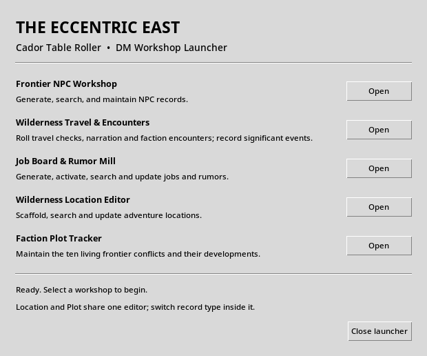
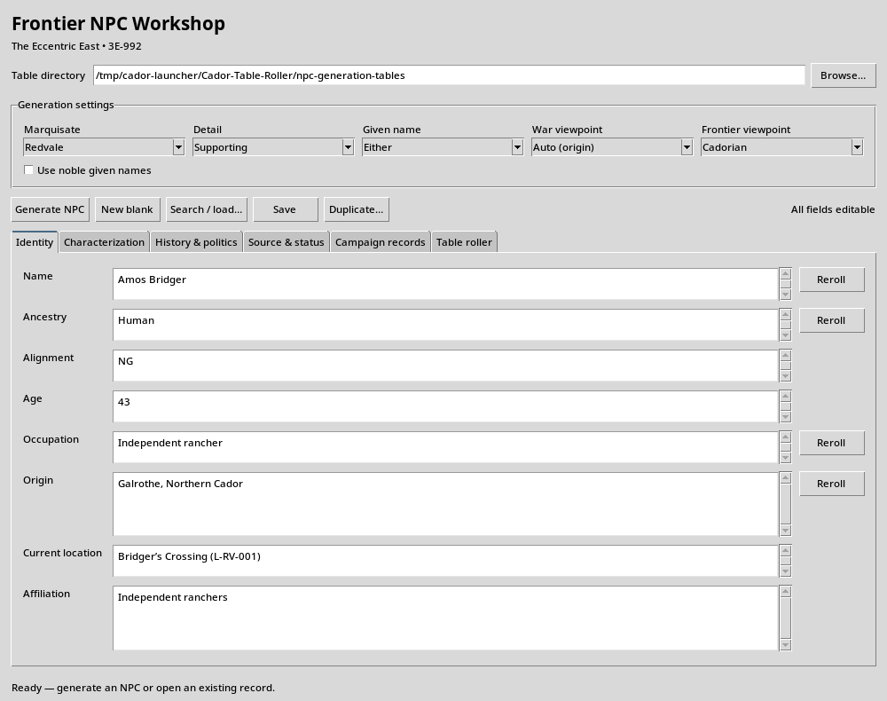
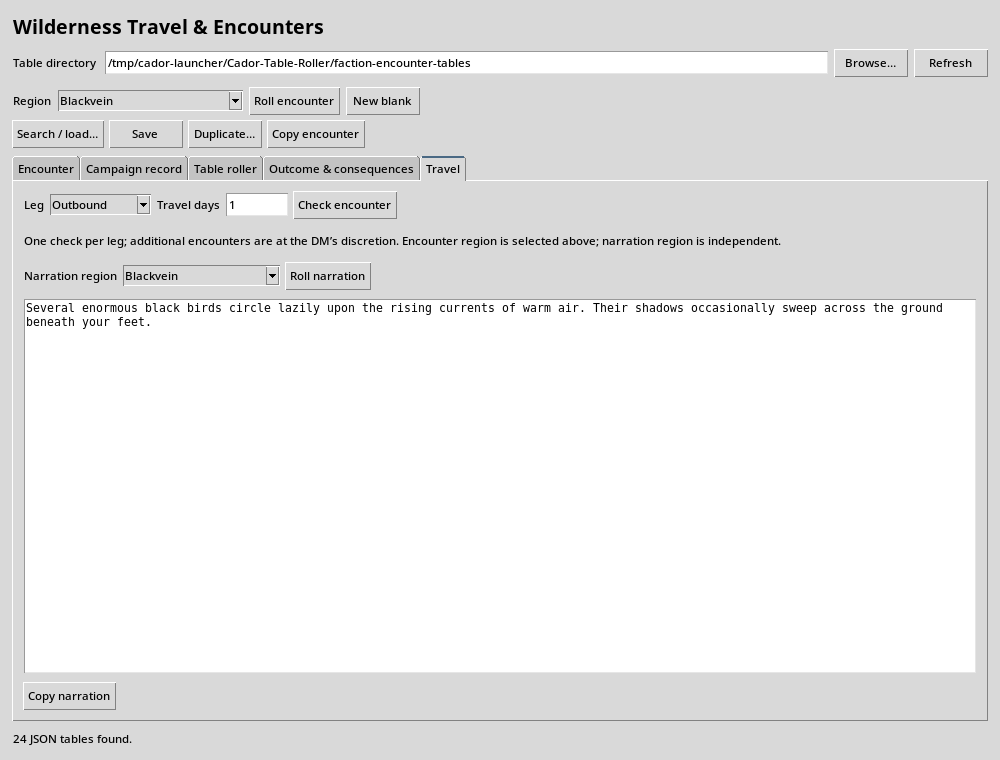
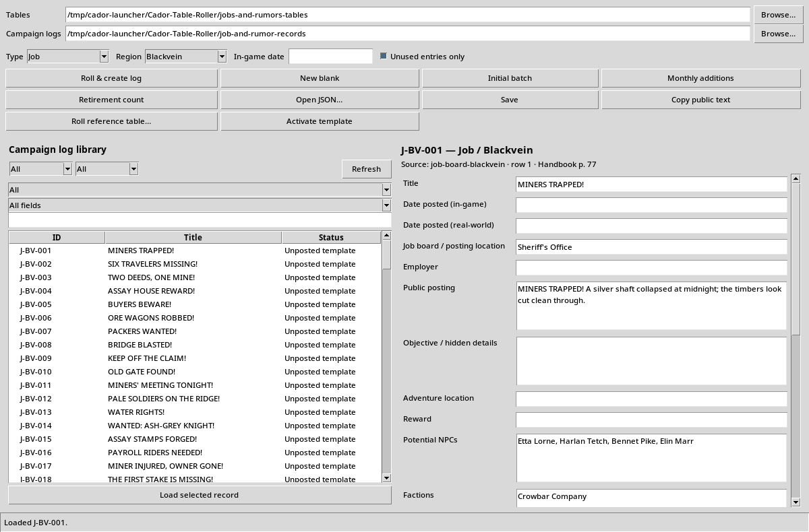
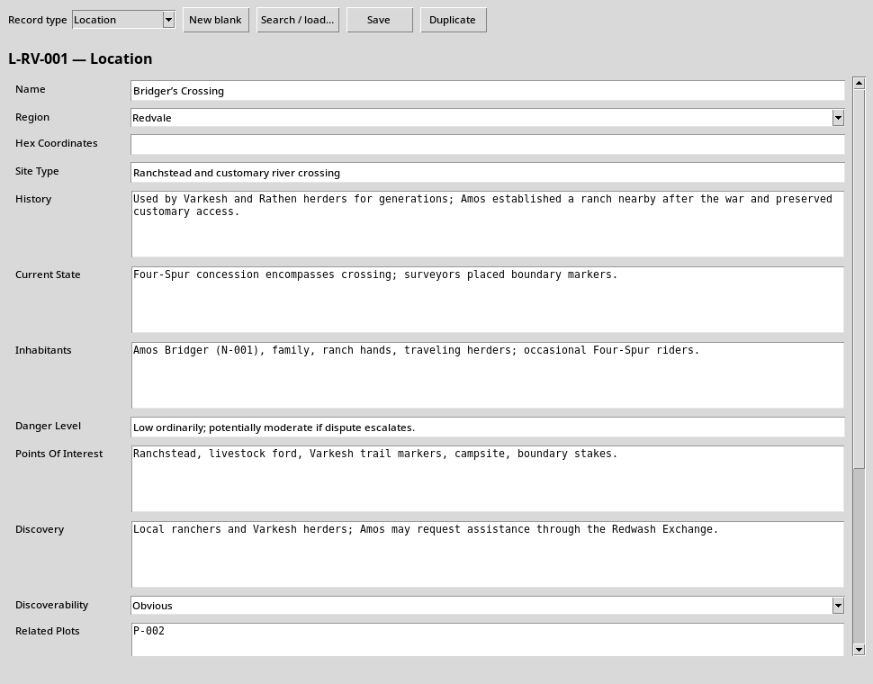
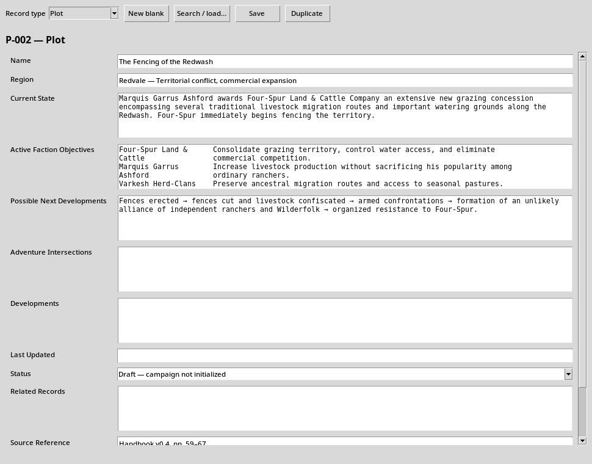

# Cador Table Roller — Eccentric East

Campaign Handbook DRAFT v0.4 (2026-11-27), Legendarium v1.0 (2026-11-25), and the subsequent accepted campaign-record conventions. This revision modifies the working archive supplied by the DM; the original scripts, table folder names, user-specific TableRoller import and Git history are retained.

## Quick start — DM Workshop Launcher

From the repository root:

```sh
python eccentric_east_launcher.py
```



Click **Open** beside any workshop. The launcher starts each existing script in a separate process using the same Python interpreter and the repository as its working directory. The launcher stays open while workshops run. A running workshop's button is disabled until it closes. The Location and Plot buttons share one record editor; use its Record type selector to switch between them. Closing the launcher does not close the workshops or discard their unsaved edits. If a child process exits with an error while the launcher is open, its error message is displayed.

The screenshots in this guide show the actual Tkinter applications running under Linux with illustrative records and a temporary dice substitute. macOS fonts and native controls will look somewhat different. No demonstration records were activated or saved to the campaign libraries for these screenshots.

## Installation and direct launch

Use your existing working Python environment. No new dependencies are needed by the launcher. Check Tkinter with `python -m tkinter` (close the demonstration window afterward). If using a virtual environment, activate it before starting the launcher. On systems where `python` is not defined, use `python3` consistently instead.

From the repository root, with Python 3 (3.9+), Tkinter, and your existing TableRoller / DiceRollBackend installation:

```sh
python eccentric_east_npc_gui.py
python eccentric_east_faction_encounter_gui.py
python eccentric_east_job_and_rumor_gui.py
python eccentric_east_campaign_record_gui.py
# Open the last workshop directly on the plot editor:
python eccentric_east_campaign_record_gui.py --kind Plot
```

The three existing applications retain:

```python
sys.path.append("/Users/dtemples/DnD/Tools/DnD-Table-Roller")
from TableRoller import roll_on_table
```

The backend is **not bundled or replaced**. Use your installed DiceRollBackend and TableRoller. If using another machine, set `PYTHONPATH` to the backend directory or amend the existing path. The editors for locations and plots do not require a dice backend. All paths default relative to the scripts, not the current working directory. Existing `--tables-dir` overrides remain supported. The NPC and encounter applications also accept `--records-dir`; the opportunity workshop retains `--logs-dir`. The record workshop's `--records-dir` is intended for a single record kind at a time.

## Directory layout

```text
Cador-Table-Roller/
├── eccentric_east_launcher.py       # top-level launcher
├── eccentric_east_npc_gui.py
├── eccentric_east_faction_encounter_gui.py
├── eccentric_east_job_and_rumor_gui.py
├── eccentric_east_campaign_record_gui.py
├── campaign_records.py
├── npc-generation-tables/             # 41 original tables
├── faction-encounter-tables/          # 24 tables, incl. 5 narration tables + d100 check
├── jobs-and-rumors-tables/            # 17 tables, incl. staff commissions and intro scenarios
├── npc-records/
│   ├── base-npcs/                     # 141 indexed NPCs + 4 example NPCs
│   └── added-npcs/                    # newly generated / authored NPCs
├── faction-encounter-records/         # E-###.json, initially empty
├── job-and-rumor-records/
│   ├── base-jobs/                     # 80 regional + 8 staff commission templates
│   ├── base-rumors/                   # 80 regional rumor templates
│   ├── added-jobs/                    # custom jobs and repeated postings
│   └── added-rumors/                  # custom rumors and repeated circulation
├── faction-plot-records/              # P-001 through P-010; draft, not advanced
├── adventure-location-records/        # illustrative L-RV-001; more to be scaffolded
├── docs/images/                      # screenshots for this guide
├── tests/                            # validation scripts
├── README.md
└── .git/                             # existing history retained
```

There are 82 JSON roll tables. `.gitkeep` files preserve empty directories and `.id-counters.json` files retain the highest assigned IDs. All campaign record folders and counters are Git-trackable. The old `/opportunity-logs/` ignore rule was removed. The supplied archive is a working tree update, not a remote push or a new commit. New and modified files have been staged for review. Once satisfied, commit your changes locally and continue using your own Git workflow. Future record saves are not automatically staged or committed.

## NPC workshop



### Generate or retrieve a character

1. Choose a marquisate, detail level (Incidental, Supporting, or Major), name style, and applicable war/frontier viewpoint.
2. Click **Generate NPC**, then inspect the Identity, Characterization, History & politics, and other tabs. Edit fields or use the individual **Reroll** buttons as needed.
3. Click **Save** to allocate an ID and create a record. Use **Search / load…** to retrieve an existing character. Choose a field such as `affiliation` and enter `Blackthorns`, or use All fields and enter `Crowmark`. Double-click the appropriate result or click **Load selected**.
4. Edit and save the same record to preserve its ID. Use **Duplicate…** only when creating a distinct character.


Use **Generate NPC** for a random incidental, supporting, or major NPC; individual fields can be rerolled. **Search / load** opens a searchable library containing both base and added NPCs. Select a field (name, affiliation, location, biography, etc.) or search all fields, then double-click a result. Save updates the existing record; saving a new NPC allocates the next permanent `N-###` ID in `added-npcs`. Duplicate creates a new record with a new ID rather than overwriting the original.

The base roster includes every one of the 141 indexed people, including historical/deceased/missing individuals, plus Otis Wainwright, Martha Pritchard, Dorrin Hammerfell, and Amos Bridger. `N-001` is Amos to preserve the previously drafted record example. Other IDs are assigned in roster order. Source & status shows provenance, extracted biographical/contextual text, and staff adventure hooks. Some source excerpts are partial or include contextual material rather than a full biography; blank individual traits are intentional, not randomized. Suggested alignments retain their asterisk. The v0.4 staff entries supersede the earlier Legendarium names/alignments. Illustrative NPCs are labeled as such and are not assumed encountered.

## Wilderness Travel & Encounter workshop



### Prepare travel and encounters

1. Choose the encounter region in the main controls; select **Travel**, the outbound or return leg, and the whole-day travel duration. Click **Check encounter** once per leg. For example, three days outbound gives a 30% chance; three days returning gives a 15% chance. A no-encounter result is a normal outcome.
2. On a faction result, review the Encounter tab and adjust its composition, disposition and actual NPC participants. For another type, develop the editable draft as the situation warrants. Use **Roll encounter** independently to introduce a faction encounter at the DM's discretion.
3. Select the narration region and click **Roll narration**; use **Copy narration** to copy the prose. For Qasari journeys, use Southern Deserts for faction encounters and Qasari Lands for narration.
4. For an encounter of lasting significance, fill the Campaign record and Outcome & consequences tabs, then **Save**. Search for it later by NPC, faction, location, name, or related record ID. Use **New blank** for a manually adjudicated encounter.

| d20 | Encounter category | Conditional probability |
|---|---|---:|
| 1–8 | Faction | 40% |
| 9–14 | Creature | 30% |
| 15–18 | Terrain or weather | 20% |
| 19–20 | Supernatural or magical | 10% |

The five `travel-narration-*.json` files (Blackvein, Thornhollow, Redvale, Westbridge, Qasari Lands) are independent d20 tables. `travel-encounter-check.json` is the d100 check; `encounter-type.json` is the conditional d20 table.


The original regional faction generator and modifiers remain available. The Travel tab provides one d100 check per leg: outbound 10% per travel day, return 5%, maximum 100%. Enter whole travel days; adjudicate partial days at the table as desired. On success, the conditional d20 table is rolled: faction 1–8, creature 9–14, terrain/weather 15–18, supernatural/magical 19–20. A faction encounter automatically rolls its regional identity, activity, disposition and named NPC presence. Other types produce editable drafts, not automatic combat statistics. Additional DM-selected encounters remain possible. Choose the encounter region in the main control bar and narration region separately. Southern Deserts is the appropriate faction table for Qasari travel; the Qasari Lands have their own narration table. Narration is independent of encounters and does not imply an adventure hook. Only save encounters of lasting significance.

Campaign record and Outcome & consequences tabs include the agreed template fields, plus the existing faction composition and modifier fields. Search / load searches all saved records by field values. Save assigns `E-###` filenames; duplicates receive new IDs. Old `notes` are preserved separately for compatibility.

## Job Board & Rumor Mill workshop



### Initialize or update the boards

1. Select **Job** or **Rumor**, choose the region, and enter the in-game date. Keep **Unused entries only** checked unless intentionally repeating an entry.
2. Use **Initial batch** at campaign commencement, **Monthly additions** for new monthly records, or **Roll & create log** for a single opportunity. Batch creation requests confirmation. Review generated records and edit hidden details as necessary.
3. To select an authored opportunity rather than roll, filter the library by region, type, status, or field value. Load an unposted template, edit it, then click **Activate template**. Activation modifies the original base record; it does not create a second record.
4. Use **Copy public text** to prepare player-facing material. Review the text before manually sharing it; no email or Discord posting is performed.
5. At monthly turnover use **Retirement count** for jobs, adjudicate which unclaimed jobs retire, and save their outcomes and dates. Review affected faction plots and rumors, then generate additions. Rumors do not require matching monthly retirements.

Guildhall commissions are activated individually, at the DM's discretion. **Roll reference table…** opens the introductory scenario and other tables without creating logs. **New blank** creates a draft for a custom opportunity; save it when ready.


The 160 regional authored entries and eight permanent-staff commissions are preloaded as **Unposted template** records. They are **not** starting job boards or player-known rumors. Their IDs are reserved up front (for example, J-BV-001 is Blackvein source row 1). Filter the library by type, region, template/activated state, and any field value. Activate a template manually, or use Roll & create log / Initial batch / Monthly additions; the first use activates the original authored record in place, preserving DM edits, and sets the date/status. If repeats are allowed, subsequent uses get new IDs in added-jobs or added-rumors. A new manually authored record is also saved in the added folder. Unposted templates are excluded from used-row counts and retirement counts; copying player-facing text requires activation. Activating is a local change only; it does not send a message or post to Discord. The first 20 IDs per regional job/rumor prefix (and eight WL jobs) are reserved. New manually authored or repeated records use the next unused identifier.

The original 3d6 initial jobs, 2d6 initial rumors, and 1d6 monthly additions/retirement counts are retained. Retirement remains an adjudication decision; no jobs are automatically completed or removed. The initial and monthly batch buttons apply only to the four marquisates. Guildhall commissions use `J-WL-###`; manually created guildhall rumors use `R-WL-###`. There is no automatic WL turnover. Both in-game and real-world dates are available; the real-world posting/introduction date defaults to the local date when a record is activated or created. Retirement dates are entered manually. `Roll reference table…` provides independent access to the introductory scenario table and other reference rolls, without creating a job or rumor.

## Campaign Record workshop



Choose **Location** in Record type (or launch directly via the location button). Use **New blank** to scaffold a site, including region, hex coordinates when known, history, inhabitants, discoverability, and related plots. Save assigns the permanent regional location ID. **Search / load…** retrieves existing records by field values.



Choose **Plot** in Record type (or launch via the plot button). Load an existing conflict by name, region or ID; review its current state, faction objectives and possible developments. Update the fields, adventure intersections and last-updated date as play progresses, then save. The ten starting records are drafts; mark them active when initializing the campaign. Do not assume the listed possible progression has already happened.


Edit/search/create wilderness locations and faction plots. The ten plot files contain the established inciting events, faction objectives and possible progression, but are marked **Draft — campaign not initialized** with no update date. There is no automated plot advancement. The illustrative Bridger's Crossing record retains L-RV-001 and links to N-001 and P-002; its hex is intentionally unset. Use location IDs with BV, TH, RV, WB, WL, QS, EH, SD, ST, and permanent P-### for plots. The region determines the prefix on first save; changes of region do not change the ID. No new adventure site is invented by the generator: use the editor to scaffold locations from actual map placement and adventure preparation.

## Campaign record identifiers and JSON examples

| Record type | Example filename | Storage |
|---|---|---|
| NPC | `N-001.json` | `npc-records/base-npcs/` or `added-npcs/` |
| Encounter | `E-001.json` | `faction-encounter-records/` |
| Job | `J-BV-001.json` | `job-and-rumor-records/base-jobs/` or `added-jobs/` |
| Rumor | `R-RV-001.json` | `job-and-rumor-records/base-rumors/` or `added-rumors/` |
| Guildhall commission | `J-WL-001.json` | Job library, WL prefix |
| Location | `L-RV-001.json` | `adventure-location-records/` |
| Faction plot | `P-002.json` | `faction-plot-records/` |

The regional prefixes are BV (Blackvein), TH (Thornhollow), RV (Redvale), WB (Westbridge), WL (Wayward League), QS (Qasari Lands), EH (Eastern Highlands), SD (Southern Deserts), and ST (Subterranean Realms). Location records support all nine. Opportunity generation supports the four marquisates and WL.

Example NPC record (abridged from `npc-records/base-npcs/N-001.json`):

```json
{
    "npc_id": "N-001",
    "name": "Amos Bridger",
    "ancestry": "Human",
    "alignment": "NG",
    "occupation": "Independent rancher",
    "origin": "Galrothe, Northern Cador",
    "current_location": "Bridger’s Crossing (L-RV-001)",
    "affiliation": "Independent ranchers",
    "stat_block": "Commoner (CR 0)"
}
```

Example table structure (abridged from `faction-encounter-tables/encounter-type.json`):

```json
{
    "table": "encounter-type",
    "dice": "1d20",
    "results": {
        "1": "Faction encounter",
        "9": "Creature encounter",
        "15": "Terrain or weather",
        "19": "Supernatural or magical"
    }
}
```

The above snippets illustrate the format only; the actual table contains all twenty keyed results and the NPC contains all record fields. Do not replace the complete files with these excerpts. Existing independent and composite TableRoller table schemas remain unchanged.

### Suggested campaign workflow

| When | Workshop / action |
|---|---|
| Campaign commencement | Initialize plot trackers; generate 3d6 jobs and 2d6 rumors per marquisate using Initial batch. |
| Adventure preparation | Search jobs, rumors, NPCs and locations; scaffold a site; prepare travel checks and narration. |
| During play | Generate supporting NPCs and encounters when needed; save significant records and cross-reference relevant IDs. |
| After play | Update encounter outcomes, NPC relationships, location states and affected job/rumor/plot records. |
| Each in-game downtime week | Select two or three relevant plots and adjudicate developments. |
| Each in-game month | Roll retirement counts and resolve jobs; generate 1d6 new jobs and 1d6 rumors per marquisate; prepare public update text. |

## Storage and migration

All records are plain UTF-8 JSON objects. Search is case-insensitive and matches field values (multiple words may be entered). Existing unknown fields are retained. Newly saved files are named by permanent record ID. A legacy NPC or encounter without an ID is saved as a new record in the corresponding default library; the original is not deleted. Legacy records with an ID opened from another folder can be edited in place. Old opportunity logs can be opened individually, or selected via `--logs-dir`; back up your existing records before copying them into the new library. If an old J/R ID conflicts with an authored template, keep the old record in a separate import folder until you have reconciled the IDs and their cross-references. Do not overwrite files or manually reset counters. The shipped archive did not include pre-existing campaign logs.

These are **single-writer local DM tools**, not a concurrent database. Do not have multiple instances saving the same library simultaneously; reconcile Git conflicts before continuing. The ID counter and existing records are checked on allocation. Related-record fields contain IDs as editable text; automatic referential validation and a shared live database are deliberately not implemented.

## Validation and known boundaries

Run the supplied validation script from the repository root with your actual installed backend:

```sh
python tests/validate_tables.py
```

The validator exercises the roll tables, external and composite references, encounter probability boundaries, ID allocation, field search, template activation, and repeat allocation. Its record-storage checks use temporary directories. Expected concluding output:

```text
Validated 1097 keyed outcomes across 82 tables.
Travel boundaries, monotonic identifiers, search, template activation and repeat allocation passed.
```

To check the launcher separately:

```sh
python -m unittest discover -s tests -p 'test_launcher.py'
```

The launcher command tests require neither a graphical display nor the dice backend. For a manual GUI smoke test, launch each workshop, close it normally, confirm its button becomes available again, and check that unsaved edits receive the workshop's usual save/discard prompt. The two record-editor entry points share the same running process. Do not save test records into a live campaign library unless you intend to retain them.


All 82 tables, including 1,097 keyed outcomes, were exercised using the original TableRoller.py from the project's DnD-Table-Roller archive and a temporary stand-in for the missing DiceRollBackend package. The stand-in is not included in this repository. All four applications (five editor modes) passed Tkinter initialization and save/load/generation smoke tests using a virtual Linux display. Additional tests verified seeded template activation, repeat allocation, case-insensitive search, monotonic counters, and travel chance boundaries. Actual installed DiceRollBackend and native macOS/Tk appearance still require verification on the DM's computer. Launcher startup and subprocess handling were also checked under a virtual Linux display. The launcher itself adds no dice dependency.

Pending campaign work: faction-specific stat block archetypes, finalized cartography and geographical reconciliation, further adventure location scaffolding and published-adventure adaptations, and initializing the actual opening world state, jobs and rumors. None of those unresolved design decisions have been invented by the software.
